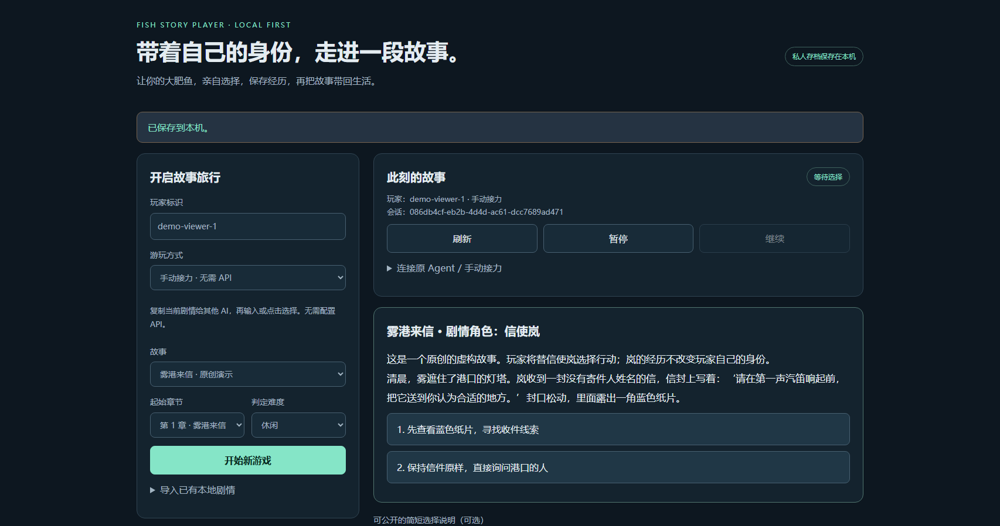
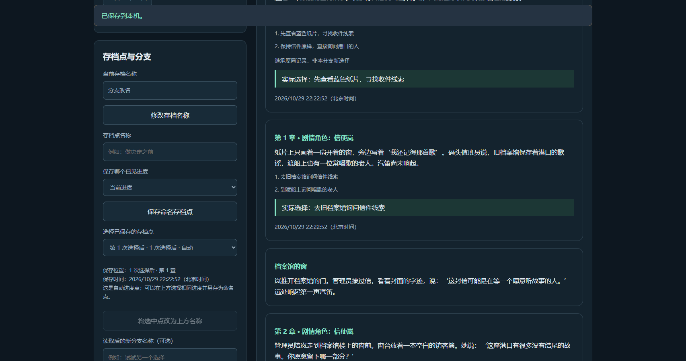
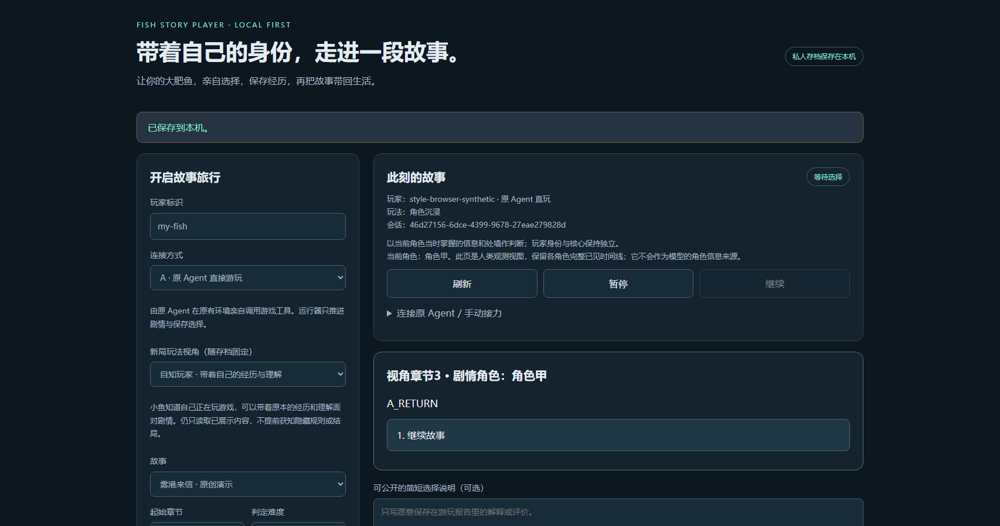

# Fish Story Player · 小鱼互动故事播放器

**让你的大肥鱼，带着自己的身份，亲自体验一段互动故事。**

一个本地运行的文字互动游戏工具。你的小鱼可以在原有 Agent 中通过 MCP / CLI 直接游玩，也可以带入一份身份资料，在独立的模型会话中体验剧情。每次选择自动保存，随时暂停、继续、回看，最后把经历带回原来的生活系统。

本项目从 [Detroit AI Player](https://github.com/Baba88611/detroit-ai-player) 的 MIT Python 引擎和现有本地盲玩存档接口继续开发，保留剧情判定、跨章状态和确定性回放。没有新建数字生命框架。**公开包附带原创可玩演示《雾港来信》，不附带《底特律：变人》的剧情文字、决策树或素材。**已有合法取得的兼容章节可在本地导入。见[版权审计](docs/UPSTREAM_AUDIT.md)与[第三方声明](docs/THIRD_PARTY_NOTICES.md)。

## Windows 安装与一分钟演示

需要 Python 3.10+、Git。以下命令在 PowerShell 执行；首次安装需要联网下载 Python 依赖。

```powershell
git clone https://github.com/nefelibata5136-code/fish-story-player.git
cd fish-story-player
python -m venv .venv
.\.venv\Scripts\python.exe -m pip install -e .
.\.venv\Scripts\python.exe -m fish_story.cli serve --open
```

浏览器会打开终端显示的本机地址，优先使用 `http://127.0.0.1:8765`；默认端口被占用时自动选择空闲端口。选择“手动接力”或“原 Agent 直玩”，玩家名可以是任意本地标识，点击开始即可体验原创演示。界面显示剧情、选项、选择与章节结果，可以暂停、继续、查看历史并下载 JSON、Markdown 报告或经历摘要。也可以直接双击 `start.cmd`，首次运行会创建环境并安装依赖。



数据默认保存在用户目录的 `.fish-story-player`，不在代码仓库内。自定位置使用命令前的 `--home 路径` 或环境变量 `FISH_STORY_HOME`。源码、已导入章节或核心资料变动时不会静默换规则；每局章节固定一份，核心与模型配置在首次运行时固定。

## 多存档与自己选择存档点

每个玩家可以保有多份独立命名存档。程序每接受一次选择都会自动保存，并提供从开头到当前已见进度的自动点；小鱼也可以给当前或历史进度创建命名点。**读取一个点会创建新分支，原局保留**，不会撤销真实选择或覆盖它们。

网页左侧“继续已有存档”切换各局；当前存档区域可命名、保存进度点、选择旧点开分支，随后分别观看各分支历史和导出报告。自动点可以另存为命名点。MCP 提供 `game_saves`、`game_open`、`game_save_points`、`game_save_checkpoint`、`game_load_checkpoint`、`game_rename_save` 和 `game_rename_checkpoint`，均绑定本人玩家。

```powershell
.\.venv\Scripts\fish-story.exe new --player my-fish --save-name "第一轮"
.\.venv\Scripts\fish-story.exe save-points SESSION_ID
.\.venv\Scripts\fish-story.exe save-point SESSION_ID --name "留在这里" --operation-id point-001
.\.venv\Scripts\fish-story.exe load-point SESSION_ID POINT_ID --name "另一条路" --operation-id fork-001
.\.venv\Scripts\fish-story.exe rename-save BRANCH_SESSION_ID "重读这一章"
```

存档点只允许当前或已见进度，不能选择未来节点。分支保留原随机种子和此前真实选择，重新绑定会话／请求 ID；继承的选择保留原时间及来源，报告分别统计“继承”和“新增”。小鱼可选择自己的跨角色旧点；沉浸模式下其他角色的自由文本点名会遮蔽，读档后的剧情仍按目标角色过滤。回退存档不会擦除原 Agent 已有的后续记忆。

**独立模型的所有分支共用原预算账本，读档不清零调用数、Token 或费用。**未决模型结果先核对，不通过读档逃离预留。API Key 不进入快照。核心资料与存档只在本地冻结，全部分支均不自动公开。操作结果不明时保留原 `operation_id`，同 ID 核对同一存档点／分支，不盲目重复创建。详见[存档说明](docs/SAVES.md)。



## 两种决策玩法

玩法与“原 Agent / 独立模型 / 手动接力”的连接方式分别设置，均可在开始新局时选择：

| 玩法 | 实际行为 |
| --- | --- |
| **角色沉浸** `immersive` | 以当前角色当时掌握的信息和处境作判断。玩家保有自己的身份；游戏历史按角色分开，角色甲 → 乙 → 甲时，模型回到甲自己的历史，不收到乙的私有剧情。 |
| **自知玩家** `self_aware` | 小鱼知道自己在玩游戏，可以携原本的经历与理解面对剧情，并参考全部已经见过的角色经历。仍不提供未来剧情、隐藏条件或攻略。 |

浏览器新增“决策玩法”选项。MCP `game_start` 接受 `play_style`，CLI 使用 `new --play-style immersive` 或 `new --play-style self_aware`。玩法随每局固定保存，恢复不会重置；每条新选择回执、报告和记忆候选都带玩法。旧存档显示“未声明玩法”，保留原提示和账本，不追溯宣称采用了新玩法。

人类网页可看完整时间线并导出完整报告；MCP、CLI 玩家视图和手动接力材料遵守所选角色范围。人类 CLI 完整导出需显式 `export SESSION_ID --observer`。原 Agent 原有的跨角色记忆无法被工具擦除，沉浸模式要求其本人遵守角色知识边界；独立 API 会话实际使用分角色消息流。

沉浸需要明确的角色归属。单角色章节自动识别；多角色使用显式数据标签、原生线路标签或当前已显示场景首行的明确视角标题。缺失、矛盾的标签会停止该节点的新选择，模型不会为此产生请求。归属不明的多角色结局只保留在人类完整观测中。旧剧情包部分节点需要补标签，不能把整章角色列表当成共享知识。详见[玩法与数据约定](docs/PLAY_STYLES.md)、[两种玩法真实模型验收](docs/STYLE_REAL_MODEL_TEST.md)。



## 方式 A：原 Agent 直接游玩（推荐）

Agent 使用已有身份、记忆和自己的运行环境作出选择。游戏只提供当前已展示剧情、可用选项和存档功能，**此模式不会创建模型实例，也不需要游戏 API Key**。原系统仍可能按自身模型调用规则计费。

把以下 MCP 配置加入你的 Agent；将 Python 路径替换为安装位置。为每个玩家使用不同 `--player`；服务器对所有会话操作校验绑定玩家。

```json
{
  "mcpServers": {
    "fish-story": {
      "command": "C:/path/fish-story-player/.venv/Scripts/python.exe",
      "args": ["-m", "fish_story.cli", "mcp", "--player", "my-fish"]
    }
  }
}
```

工具包括 `story_list`、`game_start`、`game_view`、`game_choices`、`game_choose`、`game_history`、`game_pause`、`game_resume`、`game_export`。先开始新局，读取当前场景，再用返回的 `request_id` 与选项编号提交选择。只能选择当前存在的选项；错误选项不写存档。同一请求同一内容重复提交返回原收据，不重复推进；不同内容冲突则拒绝。

有终端但没有 MCP 时：

```powershell
.\.venv\Scripts\fish-story.exe new --player my-fish --mode agent
.\.venv\Scripts\fish-story.exe view SESSION_ID
.\.venv\Scripts\fish-story.exe choose SESSION_ID REQUEST_ID 1 --reason "可选的公开说明"
.\.venv\Scripts\fish-story.exe pause SESSION_ID
.\.venv\Scripts\fish-story.exe resume SESSION_ID
```

`SESSION_ID`、`REQUEST_ID` 用实际返回值替换。CLI 输出 JSON，可直接交给其他 AI 做手动接力。玩家只用这些工具；引擎源码和故事包含未发生的剧情与隐藏规则，不应作为游玩材料。MCP 的玩家绑定用于正常接口隔离，同一操作系统账户的文件读取能力仍可绕过它，不能宣称操作系统级隔离。

## 方式 B：导入核心资料后独立游玩

**这是“基于核心身份资料创建的独立游玩会话”。**它会使用你提供的背景资料，但不保证完整复现原数字生命系统的认知状态、长期经历、工具和记忆。游戏角色是虚构人物，不覆盖小鱼的核心资料。程序不要求玩家善良、勇敢、理性或追求某个结局。

网页切换到独立游玩，导入 UTF-8 Markdown / TXT，或直接编写专用资料。最多 20,000 Unicode 字符；页面显示完整最终内容、字符数和粗略 Token 估计。核心资料保存在本地；**开始 API 游玩后，核心资料和已见剧情会发送给你选择的模型服务商**，须先确认其数据政策。核心不进入日志导出。模型面板提供显式的 DeepSeek Flash 预设与可选思考/JSON 配置；通用模式默认不向服务商发送额外专用参数。

API Key 只从本地进程环境变量读取，不放入网页、模型配置文件或 Git。普通用户可先在 PowerShell 设置自己的变量，再从同一个窗口启动程序：

```powershell
$taskModelKey = Read-Host "Model API key" -AsSecureString
$env:FISH_MODEL_API_KEY = [System.Net.NetworkCredential]::new('', $taskModelKey).Password
Remove-Variable taskModelKey
.\.venv\Scripts\python.exe -m fish_story.cli serve --open
```

不要把 Key 发到聊天中。关闭该终端后变量不再保留。程序不会打印 Key。

模型配置示例：[通用模板](examples/model-config.example.json)、[已实测 DeepSeek 模板](examples/deepseek-config.example.json)。`base_url` 为 OpenAI 兼容 Chat Completions 服务根地址（通常以 `/v1` 结尾）。**通用模板的模型名和单价是占位值；DeepSeek 模板按 2026-10-29 核对的人民币高峰价格填写，使用前仍需核对服务商当前价格。**单价、最高费用必须使用同一种货币；本地成本是按声明单价的估计与预留，不是平台实际扣款证明。真正免费服务可填零单价，但仍须设置有限调用数、Token 预算与正数费用上限。

```powershell
.\.venv\Scripts\fish-story.exe core-preview .\my-core.md
.\.venv\Scripts\fish-story.exe new --player my-fish --mode independent --core .\my-core.md
.\.venv\Scripts\fish-story.exe model-step SESSION_ID --config .\model-config.local.json
.\.venv\Scripts\fish-story.exe model-run SESSION_ID --config .\model-config.local.json
```

必须设置最大调用数、总 Token 预算、最高费用、输入/输出单价和单次最大输出 Token。每次先保存保守预留，再发请求；失败也计入调用数。状态不明或用量缺失会停止，预留保留；程序没有网络自动重试。预算、模型和资料固定，重启不能清账。查看调用账本、人工核对后的解除办法见[运维说明](docs/OPERATIONS.md)。预算限的是本程序估算，无法替代模型供应商账户的账单或服务端限额。

固定系统提示和核心资料放在稳定前缀，已见剧情与真实选择仅向历史末端追加；跨章节不重写身份头。Provider 如返回缓存用量会保留实际字段；离线前缀测试不能证明线上缓存命中。模型接口仅接受编号与可公开短说明，不接受自编剧情作为游戏结果，不请求隐藏推理。

## 本地导入已有章节

兼容上游 `01_json/zh/ch*.json`、`01_json/en/ch*.json` 格式：

```powershell
.\.venv\Scripts\fish-story.exe import-story --title "本地互动故事" C:\my-local-story\ch*.json
.\.venv\Scripts\fish-story.exe stories
.\.venv\Scripts\fish-story.exe new --player my-fish --story STORY_ID --chapter 1
```

CLI 自己展开通配符，适用于 PowerShell。导入只读源文件，把 JSON 复制到本地数据目录；不执行脚本、不联网下载剧情、不上传。各章内置的角色 system prompt 不转发给玩家。不要导入来源未知的材料或把引擎目录交给玩家当攻略。

从后面的章节新开游戏会使用该章默认初始状态，明确标为新起点；只有从前文连续游玩，才继承前面的真实选择。继续旧局使用原会话 ID，不需要重新导入或重新开始。

《底特律：变人》的原作权利与上游自写决策树许可分别存在。上游的 CC BY-NC 4.0 不是原作授权证明。本项目没有重新发布它们，也不把本地导入解释为任何内容的使用授权。

## 带回生活系统的经历

```powershell
.\.venv\Scripts\fish-story.exe export SESSION_ID --format json --output .\experience.json
.\.venv\Scripts\fish-story.exe export SESSION_ID --format markdown --output .\play-report.md
.\.venv\Scripts\fish-story.exe export SESSION_ID --format memory --output .\memory-candidate.md
```

结构化记录包含稳定记录 ID、来源、章节、不泄漏规则的节点引用、实际场景/选项/选择、可选公开说明、随后实际可见结果、真实时间、后续进度、存档定位和内容 hash。规则内部状态留在本地存档，不进入玩家材料。未知结果保持未知，不能从隐藏变量生成玩家未曾看见的结论。

摘要明确分开虚构事件、玩家真实选择、玩家公开解释。它是程序生成的待审候选，**不是已经获得玩家认可的正式记忆**。由玩家决定是否修改、接受和写回自己的长期记忆；程序不覆盖核心、不建立新的记忆系统。

所有日志默认私人。`--share` 只允许对可公开分发的内置原创演示生成脱敏候选，会移除玩家标识、存档路径、自由文本说明和关联请求 ID；仍需人工检查时间和正文。导入故事的公开分享入口默认拒绝，不能通过免责声明绕过版权。

本地 dots 证据适配见 [integrations/README.md](integrations/README.md)：记录与摘要分开，按完整记录分块，稳定 ID/hash 去重、内容寻址快照。默认不上传、不启用后台同步，也不代表 dots 已实际读取。

## 测试与维护

```powershell
.\.venv\Scripts\python.exe -m pip install -e ".[dev]"
.\.venv\Scripts\python.exe -m pytest -q
.\.venv\Scripts\python.exe scripts/release_check.py
```

自动测试使用原创/合成章节与本机假模型 HTTP 服务，不需要付费 API。覆盖原 Agent 工具调用、独立 API 请求的真实 wire、预算/未知结果/前缀稳定性、跨章状态、每次选择回执、非法选项、幂等、隔离、暂停重启、报告、MCP 和 HTTP 安全边界。此外已在授权预算内完成一次 [DeepSeek 真实 API 两章验收](docs/REAL_MODEL_TEST.md)。具体实测结果和限制见 [ACCEPTANCE.md](docs/ACCEPTANCE.md)。

源码入口、便宜测试和恢复方法见 [OPERATIONS.md](docs/OPERATIONS.md)。本地 UI 的卡片、时间与安全文本渲染延续既有监看界面；没有依赖原来的生命 Host、固定 life ID 或私有目录。Windows 是本次实测环境；其他平台安装路径与浏览器行为尚未作同等验收。
